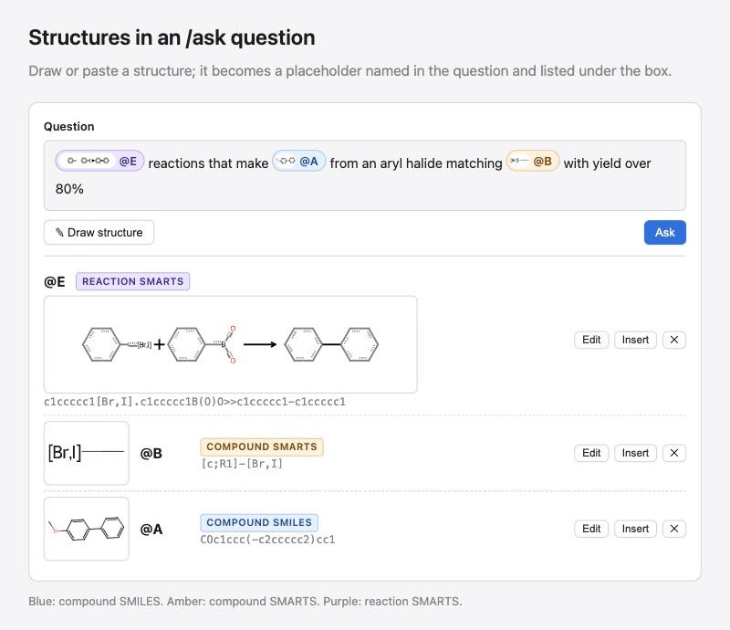

# Structures in an /ask question

- **Date:** 2026-10-17
- **Author:** Steven Kearnes
- **Acknowledgments:** Prepared with [Claude Code](https://claude.com/claude-code) (Claude Opus 5.5)
- **License:** [CC-BY-SA-4.0](https://creativecommons.org/licenses/by-sa/4.0/)

## Goal

Someone asking a question on the viewer's `/ask` page can put a structure in it, drawn in
Ketcher or pasted as SMILES or SMARTS, and the search uses exactly that structure. The
structure shows in the question as a short generated placeholder, `@A`, and is listed
under the question box. Three kinds of structure are supported: a compound SMILES, a
compound SMARTS (a pattern or scaffold), and a reaction SMARTS. An instructions page,
with worked examples, explains how to ask.

Today a question can name a compound: the model writes `"compound": "pyridine"` and the
executor resolves the name through `ord_schema.resolvers`. A structure without a usable
name cannot be asked about except by describing it — an unnamed product, a scaffold, a
pattern with an atom list, a particular transformation — and then the model writes the
SMARTS itself.



Paths are in ord-schema at
[`cc0be34`](https://github.com/open-reaction-database/ord-schema/commit/cc0be34) and
ord-app at [`7de6638`](https://github.com/open-reaction-database/ord-app/commit/7de6638).

## Non-goals

- The model reading, copying, or writing a structure.
- Any change to the query grammar, the compiler, the executor, `/api/search`, or the
  structured search form, which already takes drawn structures.
- ord-interface's `/ask`, which the viewer replaces.
- Placeholders that outlive a question: no saved library of structures beyond what the
  URL holds.

## Anti-goals

Any of these makes the feature a failure even if it otherwise works:

- A placeholder reaching a name resolver.
- The model transcribing a structure into a query.
- A query that cannot be run again without its placeholders.
- An ordinary word in a question turning into a placeholder.
- A question with no placeholders translating differently, or costing more, than it does
  today, beyond the one edit to the system prompt.

## Decisions

### Three formats

Each placeholder has one of three formats, named as the grammar names its fields: a
**compound SMILES**, a **compound SMARTS**, or a **reaction SMARTS**. The page's badges,
the API (`compound_smiles`, `compound_smarts`, `reaction_smarts`), the prompt, and the
instructions page all use these names. What each can be searched with:

| Format | `substructure` | `similarity` | `same_compound` | `same_parent` | `reaction_smarts` |
| --- | --- | --- | --- | --- | --- |
| compound SMILES | yes, read as SMARTS, as the search form reads a drawn substructure | yes | yes | yes | no |
| compound SMARTS | yes | no | no | no | no |
| reaction SMARTS | no | no | no | no | yes |

A reaction drawn without query features is still a reaction SMARTS: `reaction_smarts`
reads a reaction SMILES as SMARTS.

### What the model sees

The model sees each placeholder's name and format, never its text. The first user
message carries the question and, after it, one line per placeholder:

```text
@A is a compound SMILES.
@B is a compound SMARTS.
@E is a reaction SMARTS.
```

The model picks the predicate from the wording, as it does for a named compound: `@A`
alone means that compound, "containing @A" a substructure, "similar to @A" a similarity
search, "@A or a salt of it" the same parent. It writes the placeholder's name where the
structure goes. A question asking a format for something it cannot do, such as "similar
to @B" where `@B` is a compound SMARTS, is declined through `cannot_answer` with a reason
naming the format. It is not answered as a substructure search, because that is a
different question.

The placeholder lines go in the user message, so the cached system prompt stays the same
from one question to the next. A question with no placeholders gets no extra lines.

### Substitution before validation

Placeholders are substituted into the model's query before it is validated. They are not
resolved when the query runs. After `_unwrapped(_coerce(...))` and before `_validated`, a
pass over the query replaces each placeholder in a structure slot with its text, in the
field the predicate takes: `smarts` for `substructure` and `reaction_smarts`, and
`smiles` for `similarity`, `same_compound`, and `same_parent`. A structure slot is
`compound`, `smiles`, or `smarts` on one of those five predicates, so the model's choice
among the three keys does not matter. Any `compound` key is removed. The query is then
validated and compiled like any other.

What follows from this:

- **The grammar, compiler, and executor do not change.** A placeholder exists only in
  `ord_schema.search.nl` and the viewer.
- **The query that runs names its structures outright.** `Answer.query`, `/api/ask`'s
  `query`, and the page's "The query it ran" all show the substituted query, so it runs
  again through `/api/search` as it stands.
- **The grammar's own checks apply to the placeholder's text.** A SMARTS that does not
  parse or has no atoms is refused. Hydrogens a stored molecule holds implicitly are
  folded into heavy-atom counts. A reaction SMARTS may hold at most five templates on a
  side.
- **A placeholder never reaches `ord_schema.resolvers`.** Each of the following is an
  error naming the placeholder and what would work, handed back through the existing
  repair turn: a placeholder with no binding, a format the predicate does not take, or a
  placeholder anywhere other than a structure slot, such as a comparison's literal.
- **A placeholder is a slot's whole value.** A `reaction_smarts` composed around
  placeholders, such as `"@A>>@B"`, is an error, since the model would then be writing
  structure text. "Reactions turning @A into @B" is an `exists` over reactant inputs and
  another over products, which the grammar already expresses.

The alternative was a resolver that checks the bindings before PubChem, and it was
rejected. The executor reads every resolved compound as SMILES, so a compound SMARTS or a
reaction SMARTS would have needed grammar and executor changes. The query that ran would
also have named `@A`, and could not run again without the bindings.

### Names

A placeholder is `@` followed by uppercase letters, generated by the page: `@A` through
`@Z`, then `@AA`. A name is never reused while the question is edited, so deleting `@B`
does not make the next drawing `@B`.

### The drawing decides its format

There is no format toggle in the dialog. On save, a drawing with a reaction arrow is a
reaction SMARTS. A drawing with any query feature (a generic atom, an atom list, a query
bond, or a query atom property) is a compound SMARTS. Anything else is a compound SMILES.
An R-group position is read as any atom (`*`). The dialog's footer names the
placeholder and format before saving, for example "Saves as @D · compound SMARTS".
Atom maps drawn in a reaction stay in its text; the search ignores them, as it does now.

### Pasting

Pasting into the question box replaces each whitespace-separated token that both:

1. holds a character an ordinary word does not: a digit or one of `[ ] ( ) = # + / \ >`;
2. parses as a SMILES, a SMARTS, or a reaction SMARTS

with the next placeholder. Its format is decided by the same rule as a drawing's.
Sentence punctuation at the end of a token (`.` `,` `;` `:` `?` `!`) is set aside before
the check and left in the text. A note under the box names what was replaced and offers
undo.

Words such as `CO`, `I`, and `No` contain none of those characters, so they stay text.
`2-pyridone`, `(S)-ibuprofen`, and `70%` contain them but do not parse, so they stay text
as well. The same conversion runs on any qualifying token still in the box when **Ask**
is pressed, so a typed SMILES is handled like a pasted one, and the box shows the marker
before the request is sent.

### The list under the box

Each placeholder gets a row with:

- a thumbnail;
- the name;
- a format badge, in blue for compound SMILES, amber for compound SMARTS, and purple for
  reaction SMARTS;
- the text;
- **Edit**, which reopens Ketcher on the structure and keeps the name;
- **Insert**, which puts the marker at the cursor;
- **✕**, which removes the row.

A reaction's row is full width. In the question box, a marker shows as a token with a
small thumbnail, in its format's color.

A marker with no row is shown as undefined, and **Ask** is disabled with a message
saying so. That covers a marker typed by hand and one left behind after its row was
removed. A row whose marker no longer appears in the question stays in the list, so
Insert can put it back, but it is not sent.

### The URL

The URL carries the placeholders beside `q`, so a reload, Back, or a shared link
reproduces the question. The encoding must round-trip any SMILES or SMARTS text exactly.
SMARTS can hold `,` and `;`: the search form's legacy `component=` parameter has to
split `[C;R]Cl` from the right.

### Bounds

A question holds at most 10 placeholders, and each text is at most 2,000 characters.
Each structure predicate is a pass over the corpus's structures, so a question's cost
grows with the number of placeholders.

## The instructions page

`/ask/help` is linked from the `/ask` page, beside the question box, and from its
in-development note. It covers:

- **What `/ask` does.** An English question becomes a search query, shown under "The
  query it ran", and a sentence describes what it found.
- **Naming compounds.** A common name is resolved to a structure, so a named compound
  needs no drawing.
- **Drawing and pasting.** How to draw or paste a structure, how placeholders appear in
  the question and the list, and how to edit, insert, and remove them.
- **The three formats, in plain words.** What each can be asked, and the wording that
  picks each kind of search: `@A` alone, "containing @A", "similar to @A", "@A or a salt
  of it".
- **Limits:**
  - at most five templates on each side of a reaction SMARTS;
  - a compound SMARTS cannot be searched for similarity or identity;
  - drawn stereochemistry is respected unless the question says otherwise;
  - a reaction SMARTS with several templates on a side returns fewer reactions than
    the old site's search did
    ([2026-10-02](../../2026-10-02-reaction-smarts-without-the-cartridge/README.md)).

### Examples

Each example is a question with its placeholders drawn beside it. Its **Try it** button
opens `/ask` with the question and placeholders filled in, and asks it. Together the
examples cover every format and every kind of structure search they can drive, and
include a question that mixes a name with a placeholder and a yield or a condition. A
starting set:

| Question | Placeholders | Shows |
| --- | --- | --- |
| reactions that make @A | `@A`, a compound SMILES | the same compound |
| reactions whose product is similar to @A | `@A`, a compound SMILES | similarity |
| reactions using a reactant containing @A | `@A`, a compound SMILES scaffold | a compound SMILES as a substructure |
| reactions using an aryl halide matching @B with yield over 80% | `@B`, `c[Br,I]` | a compound SMARTS, with a yield |
| @E reactions run in THF | `@E`, a Suzuki coupling's reaction SMARTS | a reaction SMARTS beside a name |
| reactions using benzene as an input with yield greater than 70% | none | a name alone |

Each example's structures are chosen so that it returns reactions from the deployed
corpus. Every example, with its placeholders, is also an evaluation case in
ord-schema's `nl_cases.json`, so a prompt change that breaks an example fails the
evaluation. The three example buttons already on `/ask` stay as they are.

## Changes by repository

### ord-schema

This lands first, and ord-app picks it up from a release made through `publish.yml`.

- **`ord_schema.search.nl`:**
  - A placeholder type holding a name, a format (an enum of the three), and the text.
    It is validated when built: the name matches `@[A-Z]+`, and the text passes the
    grammar's own validator for its format. That means `Substructure` with `smarts` for
    a compound SMARTS, `SameCompound` with `smiles` for a compound SMILES, and
    `ReactionSmarts` for a reaction SMARTS.
  - `translate` and `ask` take `structures`, mapping each name to its placeholder. It
    is empty by default, and an empty mapping changes nothing.
  - The placeholder lines in the first user message, and the substitution pass and its
    errors, as described above.
  - `nl_prompt.md` gains a section on placeholders: where to write one; which formats
    each predicate takes; to decline rather than run a different search; that a
    placeholder is neither a structure to write out nor a compound name. The prompt
    fingerprint changes once, with that edit.
  - `answer()` sees the question with its markers, so its sentence says "@A", as the
    page does.
- **`nl_log`.** `Attempt.translation` keeps what the model wrote, placeholders and all,
  because prompt work reads that. `Ask` gains `structures`, the bindings, so a record
  replays exactly.
- **`nl_eval`.** `EvalCase` gains optional `structures`, and references keep naming
  their structures outright. New cases:
  - each format in each predicate it takes;
  - each format a predicate refuses, with `compiles: false`;
  - a placeholder beside a named compound;
  - every example on the instructions page.
- **No change to `query`, `execute`, or `resolvers`.**

### ord-app

- **Backend, `routes/ask.py`.** `AskRequest` gains `structures`, mapping each name to
  `{format, text}`. It is optional and bounded as above. A 422 names the placeholder
  when:
  - a binding fails validation;
  - a marker in the question has no binding;
  - a binding is not in the question.

  `AskResponse` keeps its shape, and its `query` is the substituted one.
- **Frontend:**
  - **`AskPage`:**
    - token rendering in the question box, which a plain Mantine `Textarea` cannot do;
    - **Draw structure**;
    - paste conversion with undo;
    - the rows and undefined markers;
    - placeholders in the URL;
    - `useAsk(question, structures)`, keyed on both.
  - **`StructureDialog`** in `packages/ui` gains a mode where `onSave` receives
    `{format, text}`, with the format decided from the drawing as above. The search
    form keeps passing a fixed format.
  - **The instructions page,** its route, and the links to it.
  - **Tests:**
    - unit tests for the paste rule, using `CO`, `I`, `No`, `2-pyridone`, `70%`, a
      SMILES followed by a period, and a reaction SMARTS;
    - unit tests for format detection, the URL round trip of SMARTS holding `,` and
      `;`, and undefined markers;
    - end-to-end tests with the scripted model client for each format and for an
      example's Try it.

## Left to the builder

- How the box renders markers as tokens.
- How the dialog detects query features and reactions in Ketcher's drawing.
- Where paste parsing runs: Ketcher's structure service in the browser, or a backend
  check.
- How thumbnails are drawn: the shared preview renderer or Ketcher's structure service.
- The URL encoding.
- The wording of errors and of the instructions page.
- The examples' exact structures.
- Whether ord-app's backend and frontend land in one PR or two.

## Calls made in writing this

These were settled while writing the design rather than in discussion:

- Substitution before validation, in place of a resolver for placeholders.
- A format a predicate refuses is declined rather than run as a different search.
- A placeholder is a slot's whole value.
- The paste rule's characters and its handling of trailing punctuation.
- Converting qualifying tokens when **Ask** is pressed, not only on paste.
- An R-group position is any atom.
- The bounds: 10 placeholders, each at most 2,000 characters.
- Names are never reused, and `@AA` follows `@Z`.
- Rows whose marker has left the question are kept but not sent, and the backend refuses
  a binding the question does not use.
- The `/ask/help` path, and keeping the three example buttons on `/ask`.
- The examples double as evaluation cases.
- The ask log records the bindings, so a record replays.
- The answer sentence names placeholders as the page does.
